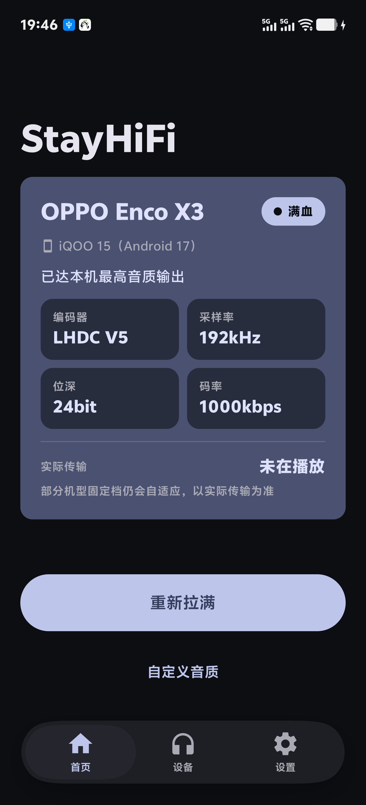
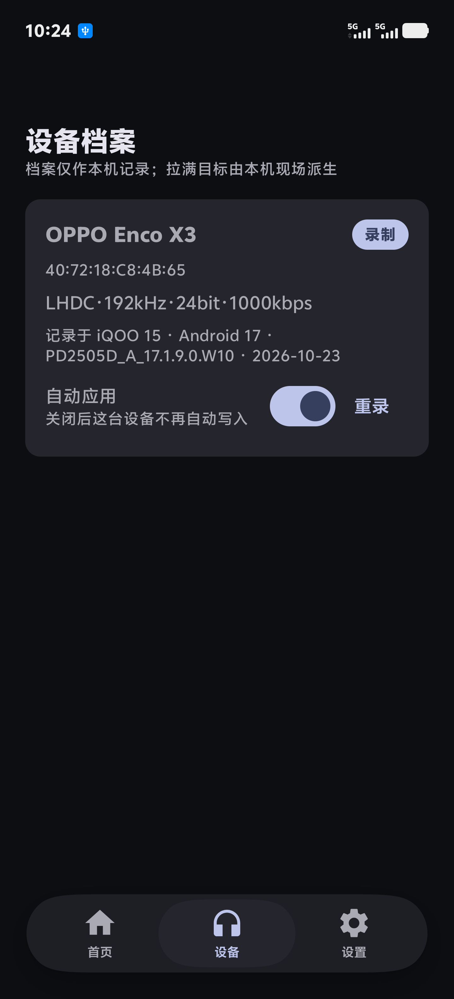
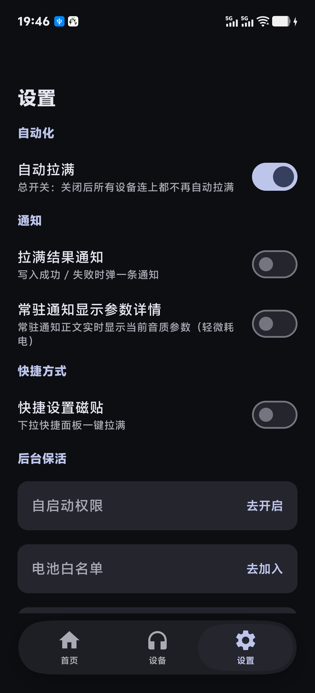

  
  <h1>StayHiFi 音質常駐</h1>
  
<strong>藍牙耳機一連，音質自動拉滿——免 root，裝完就不用管</strong>

  
<a href="README.md">簡體中文</a> | [繁體中文] | <a href="README.en.md">English</a> | <a href="README.ko.md">한국어</a>

  

    
    
    
    
  

## 為什麼需要 StayHiFi

廠商出於相容與功耗考量，藍牙編碼預設走保守參數（如 SBC / 48kHz / 自適應碼率）——花 HiFi 的錢，聽 MP3 的聲。想跑滿耳機的真實能力，只能每次連線後鑽進**開發者選項**手動調 codec / 取樣率 / 位元深度，而且**斷線重連、關掉開發者選項都會復原**，第二天一切重來。

StayHiFi 替你盯死這件事：連上耳機的一瞬間，把參數寫回這台裝置協商得出的上限，全程無感。拉滿後遇到無聲、雜音，或你就是想換個口味，也可以在自訂音質裡手動微調，隨時一鍵恢復自適應。

## 螢幕截圖

  
  
  

## 功能特性

- **連上即拉滿**：任何藍牙耳機零適配——目標參數按「耳機×手機×ROM」現場推導，寫入後讀回驗證；觸發合併、斷線保護，重連與開始播放時更穩
- **狀態卡一眼看懂**：「已達本機最高音質輸出」/「未拉滿 · 點按鈕重試」/「自訂參數生效中」/「已連線，授權後可用」如實陳述，不冒認
- **斷線重連自動再拉**：前景服務監聽連線事件，近零耗電，無輪詢空轉
- **自訂音質**：編碼器 / 取樣率 / 位元深度 / 碼率可按目前連線能力手動調整；拉滿後無聲、雜音時可降檔，一鍵恢復自適應；置灰檔位 = 目前手機或耳機暫不支援。自訂狀態只如實顯示「自訂」，絕不冒認拉滿——自動拉滿的預設規則不變
- **身份與實況診斷**：核對本機實際生效的編碼器身份，即時顯示實際傳輸碼率；部分機型固定檔仍會自適應，以實際傳輸為準
- **常駐靜默通知 + QS 快捷方塊**：可選即時顯示目前參數；QS 方塊一鍵觸發重拉，無已連線裝置時開啟 App
- **iOS 風浮動 Dock 導覽**：彈簧透鏡 + 果凍變形物理動效，拖拽跟手
- **記錄目前參數**：入口在裝置頁，抓一次目前協商參數存檔，附機型 / Android 版本出處；機型名離線可查（v1.2.2）
- **隨時一鍵還原**：裝置頁可把參數寫回首次拉滿前的原始協商值
- **Material You**：動態取色，深淺色主題隨系統

## 運作原理

透過 **Shizuku 或 Stellar**（任選其一，免 root）取得 shell 級特權；已 root 的裝置也可改用 **Root 通道（實驗）**，隨時可切回。反射呼叫系統藍牙堆疊的隱藏介面 `setCodecConfigPreference()` 寫入 A2DP codec 設定。

- **不 patch 系統、不解鎖隱藏 codec**，不突破硬體已協商的能力上限——Root 只替換特權通道，不提升音質上限
- Root 通道的機型覆蓋仍在收集外部樣本，尚未宣稱穩定支援，遇到問題歡迎回饋
- 系統藍牙連線與特權讀取解耦：未授權也能讀本機 A2DP 連線與耳機名；詳細參數查看與寫入才需要授權
- 功能層面的外部互動僅是與 Shizuku / Stellar / Root 的本機 IPC；唯一網路請求是 GitHub Releases 版本檢查

## 安裝

> ⚠️ 官方通路目前**僅有 GitHub Releases**（酷安上架中），其他來源的 APK 請勿安裝。

1. 準備特權（二選一）：安裝 **Shizuku** 或 **Stellar** 管理器，並依其指引啟動（無線偵錯 / 有線 adb，無需 root）；已 root 的裝置也可在 App 內改用實驗 Root 通道
2. 從 [GitHub Releases](https://github.com/chengzi2333/StayHiFi/releases) 下載 APK——**單一包通用所有機型**，無需挑選 ABI 版本；頁面附 SHA-256 與簽名憑證指紋，安裝前可核對

要求：Android 10+。

## 使用

1. 首次開啟跟隨**四步引導**：選擇特權方式 → 授權 → 連接耳機 → 常駐設定。連線異常時，連接頁有「排障日誌」入口，可就地查看並複製日誌回饋
2. 常駐「三道閘」（國產 ROM 殺背景嚴格，全做才穩）：
   - **允許自動啟動**（系統設定 → 應用程式管理）
   - **加入電池白名單**（關閉電池最佳化）
   - **背景高耗電 + 卡片鎖定**：設定 → 電池 → 背景耗電管理 中允許本應用程式；並在最近工作中下拉卡片點「鎖定」，防滑卡清理
3. 之後正常使用即可：耳機一連，參數自動拉滿；首頁狀態卡即時告訴你有沒有到頂。想微調就用首頁的「自訂音質」按目前連線能力手動調整，異常時降檔或一鍵恢復自適應；未授權時也能看到已連線的耳機名，授權後參數才會展示與寫入

## 解除安裝

寫入的參數偏好會持久保存在系統藍牙堆疊中，**解除安裝 App 不會自動還原**。想回到預設：解除安裝前在裝置頁點「恢復預設參數」，把參數寫回首次拉滿前的原始協商值。除此之外無任何殘留——不碰系統檔案，解除安裝即淨。

## 意見回饋與交流

裝置型號眾多、各家 ROM 差異大，難免有覆蓋不到的機器。遇到問題歡迎透過任一管道找我：

- **GitHub Issues**：回報 bug、提出需求的首選，附 App 內「日誌」頁「複製日誌」的輸出最佳——日誌已自動脫敏（MAC / 裝置名映射為 deviceN），直接貼上即可，請勿改寫或補充未脫敏原文
- **酷安**：@一般社畜橙子（CoolApk 帳號）
- **小紅書**：@橙橙橙子Orenji（Xiaohongshu 帳號）

## 隱私

- **零資料蒐集**：所有資料只儲存在本機，無網路上傳、無統計埋點、無帳號體系
- **唯一網路請求** = GitHub Releases 版本檢查（僅版本號比對，不攜帶任何裝置資訊；每天至多一次靜默檢查，也可在設定頁手動觸發）
- 其餘唯一的外部互動是與 Shizuku / Stellar / Root 的本機 IPC——無論哪種特權通道，都只在本機通信

## 免責聲明

本專案與 **Shizuku、Stellar、OPPO、vivo** 及其關係企業無任何隸屬、贊助或認可關係；所有商標歸其各自所有者。僅在你自己的裝置上調整系統隱藏介面（反射呼叫）的參數，請自行評估風險。

## 開源許可

GPL-3.0-or-later，詳見 [LICENSE](LICENSE)。第三方元件宣告見 [NOTICE](NOTICE)，裝置檔案貢獻指引見 [CONTRIBUTING.md](CONTRIBUTING.md)。

原始碼可自由使用與修改，但 **「StayHiFi / 音質常駐」名稱與圖示不屬於授權範圍**——fork 或二次發布請更換名稱與圖示（參照 Shizuku / Seal 的通行做法）。
